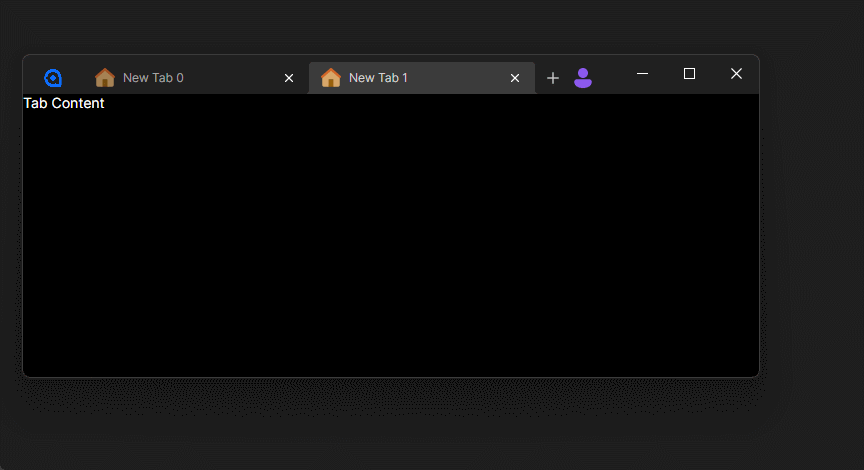

# TabView.Avalonia

[](https://www.nuget.org/packages/TabView.Avalonia)

A brand-new `TabsView` control that supports dragging and tearing, based on the `TabbedPage` control in [Avalonia](https://github.com/AvaloniaUI/Avalonia/) 12 and the [Tabalonia](https://github.com/egorozh/Tabalonia/) repository. AOT compatible.



## Usage

Install the package from NuGet:

```pwsh
Install-Package TabView.Avalonia
# Or 'dotnet add package TabView.Avalonia'
```

Add the Style to your App.axaml:

```xml
<Application xmlns:tabView="using:TabView.Avalonia">
    ...
    <Application.Styles>
        ...
        <tabView:TabsViewFluentTheme />
    </Application.Styles>
<Application />
```

And use the control just like `TabbedPage`:
```xml
<tabView:TabsView>
    <ContentPage Header="Tab 1" />
    <ContentPage Header="Tab 2" />
    <ContentPage Header="Tab 3" />
</tabView:TabsView>
```

But if you want to support AOT, you need to override the `TabsView.InterTabController` property and implement the `IInterTabClient` interface, like this:

```cs
MyTabsView.InterTabController = new InterTabController { InterTabClient = new AotInterTabClient() };

private sealed class AotInterTabClient : IInterTabClient
{
    public TabsHost GetNewHost(InterTabController controller, TabsHost host)
    {
        var window = new MainWindow { Owner = host.Window };
        return new TabsHost(window, window.MyTabsView);
    }
}
```

To disable tearing, you can set the `TabsView.InterTabController` property to `null`:

```cs
MyTabsView.InterTabController = null;
```
